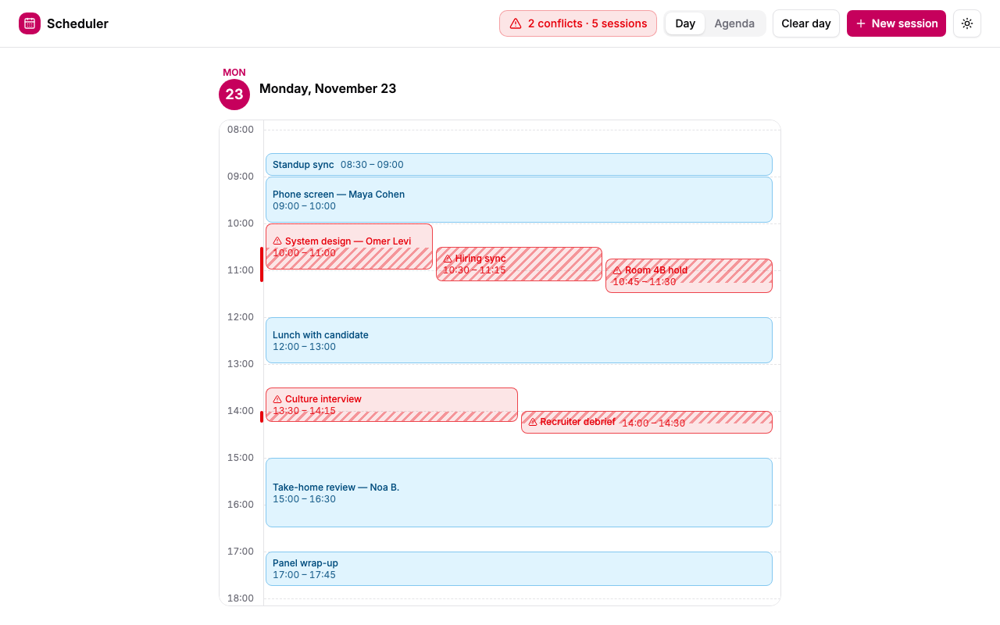
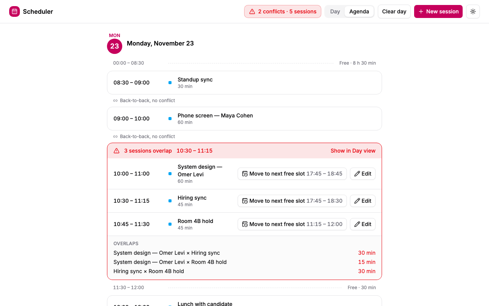

# Conflict-Aware Scheduler

A single-page app for planning one day of sessions and seeing where they collide. It opens on a sample day with two conflicts, shows the day as a time grid (**Day**) or as a list (**Agenda**), and helps you resolve each conflict by dragging, editing, or moving a session to the next free slot.

Live at https://conflict-aware-scheduler.itaysidis.workers.dev. CI deploys every push to `main` to Cloudflare Workers.

<p>
  
  
</p>

## Run it

Requires Node 20.19+ or 22.12+.

```bash
npm install && npm start
```

Then open http://localhost:3000. With [Bun](https://bun.sh), which CI uses and whose lockfile is committed: `bun install && bun start`.

There is no backend. The schedule lives in memory, so a reload brings back the sample day.

## Tests

```bash
npm test                              # unit and component tests (Vitest, jsdom)
npx playwright install chromium       # once: download the browser
npm run test:e2e                      # end-to-end tests (Playwright, Chromium)
npm run typecheck && npm run check    # TypeScript, then Biome format and lint
```

CI runs all of these, plus the build, on every pull request.

## What it does

- **Day view**: a vertical 24-hour grid. Overlapping sessions sit side by side in lanes, only the minutes they share are hatched, and a red bar in the hour gutter marks each conflict.
- **Agenda view**: the day as a time-ordered list, with free slots between sessions and one card per conflict. Each card lists its sessions, every overlapping pair with its shared minutes, and offers **Move to next free slot**, **Edit** and **Show in Day view**.
- **One dialog** adds and edits sessions in both views. It shows the end time and previews overlaps as you type.
- **Header**: a conflict summary ("2 conflicts · 5 sessions") that links to the Agenda, the Day/Agenda switch, Clear day, New session, and a light/dark/system theme menu.
- **Drag** (the extension): move a session up or down the Day grid with a mouse, a finger or the keyboard. Conflicts update on every 15-minute step.

## Edge cases

| Case              | What happens                                                                                                                                                                                                                                                                  |
| ----------------- | ----------------------------------------------------------------------------------------------------------------------------------------------------------------------------------------------------------------------------------------------------------------------------- |
| Invalid input     | The dialog shows the error under the field and disables Save. A title must be 1 to 80 characters. A start must be a valid HH:mm on the 5-minute grid. A duration must be 5 minutes to 24 hours, in 5-minute steps.                                                            |
| Back-to-back      | Not a conflict, because a session covers [start, end). The Agenda shows "Back-to-back, no conflict" between them.                                                                                                                                                             |
| Crossing midnight | A session can start as late as 23:55 and last up to 24 hours. The Day grid draws it to the bottom edge with a "continues tomorrow" cue, and the Agenda marks its end "ends next day".                                                                                         |
| Empty schedule    | Both views show "Nothing scheduled" with an **Add the first session** button. Clear day gets you there from the sample day.                                                                                                                                                   |
| Crowded schedule  | The Day grid shows at most three lanes. The rest of a conflict folds into a `+N` link that opens the Agenda filtered to that conflict, which lists every session. When the day has no gap long enough, **Move to next free slot** is disabled and reads "No free slot today". |

## Product decisions

The vocabulary (Schedule, Session, Duration, Back-to-back, Overlap, Conflict, Free slot) is defined in [GLOSSARY.md](GLOSSARY.md), and code and UI use the same words. The two decisions with the most consequences are recorded as ADRs.

- **Conflicts warn, they never block** ([ADR 0001](docs/adr/0001-conflicts-warn-never-block.md)). People double-book on purpose: a room hold during the meeting that needs it, or a tentative slot. Refusing the save would push them to work around the tool. Saves and drops always go through, and the conflict stays visible until it is resolved. Only invalid input blocks a save.
- **The schedule is one day, and a session may run past midnight** ([ADR 0002](docs/adr/0002-one-day-schedule.md)). This handles the brief's midnight case without multi-day storage, navigation or cross-day conflicts.
- **A session covers [start, end)**, so back-to-back sessions share no minute and are not flagged. A tight but valid day should not look broken. Identical sessions and one session inside another do overlap.
- **A conflict is a connected group, not a pair.** Sessions at 09:00–10:00, 09:30–10:30 and 10:15–11:00 are one conflict made of two overlaps. The header count then matches the number of problems to solve, and each card keeps related overlaps together.
- **Colour is never the only signal.** Conflicts are red and also hatched, carry a warning icon, and have screen-reader text ("In conflict").
- **"Move to next free slot" is predictable and never creates a new conflict.** It picks the earliest start at or after the session's current start where its full duration fits, no later than 23:55. One deterministic fix per session is easier to trust than a ranked list of suggestions.
- **Times are 24-hour HH:mm on a 5-minute grid**, the same everywhere, which removes AM/PM and locale ambiguity.
- **The view is in the URL** (`?view=day|agenda`, plus `&conflict=` for a filtered or highlighted conflict), so reload, Back and shared links keep it.
- **First load shows a realistic sample day**, matching the design boards in `sketches/`, so the app's purpose is visible immediately.

## Technical decisions

- **TanStack Start, React 19, TypeScript, Tailwind and shadcn/ui.** Start gives a typed router with validated search params (Zod), which carries the view and conflict state. shadcn provides accessible primitives (dialog, menu) and theme tokens, so dark mode came from tokens rather than per-component colours.
- **The domain is pure TypeScript** in `src/schedule/`, with no React or DOM. `schedule.ts` holds the session type, a reducer (add, update, delete, clear, load sample day), and the derived queries: conflicts, overlaps, free slots and next free start. `session-draft.ts` turns the dialog's raw text into a session or per-field errors. `day-layout.ts` computes lanes, hatch ranges, gutter markers and `+N` overflows. Everything the UI shows is derived from one serializable `Session[]`, so nothing can drift out of sync, and adding persistence does not mean restructuring.
- **Conflict detection sorts once and sweeps.** Sorted by start, a run of sessions stays one group while each next session starts before the run's latest end. That gives connected groups in O(n log n). Pairs are only compared inside a group.
- **The drag preview reuses the layout.** While a session is dragged, the Day view lays out a hypothetical schedule with the session at its landing time. Lanes, hatching, gutter markers and highlights follow every step without any drag-specific drawing code.
- **Tests are chosen by layer:**
  - _Unit (Vitest)_: an edge-case matrix for the schedule module, one line of data per case. It covers every edge case above, plus drag rounding and the next-free-slot rule.
  - _Component (React Testing Library)_: user flows driven by role and label. Saving an overlapping session updates the summary and the cards, invalid input disables Save, Move to next free slot clears a conflict, and keyboard dragging moves a session and announces it.
  - _End-to-end (Playwright)_: what needs a real browser and the production build, which jsdom does not have. The redirect from `/` and the URL parameters across reloads, the stored theme applied before any app script runs, the grid's opening scroll and lane geometry, mouse, touch and keyboard drags, and focus after each dialog save and card move, plus a smoke test that the built app loads.

  Tests assert what users can observe, never lane numbers or fixed pixel positions.

## The extension: drag-and-drop

**Why.** The core of the brief is "make it easy to resolve" conflicts. On a time grid, the most direct fix is to grab the session and move it, and watching the hatching appear or clear on each step teaches the overlap rule better than any message. It also builds on the code that was already there. A drop goes through the same reducer action as the editor, and the live preview is the existing layout run on a hypothetical schedule. The other options were weaker fits: timezones fight the one-day model, and persistence with undo is mostly plumbing that shows little about conflicts.

**How it was scoped.**

- Day view only, vertical moves only. Dragging changes the start, never the duration (no resize handles).
- Moves snap to 15-minute steps from the session's original start, and the start is clamped to 00:00–23:55. A session dragged late keeps its full duration and runs past midnight.
- A live gutter label shows the landing time, and conflicts update on every step. Dropping into a conflict is allowed, following ADR 0001.
- **Mouse**: a drag starts after 5 px of movement, so a click still opens the editor. **Touch**: hold for 250 ms, so a quick swipe still scrolls the grid. **Keyboard**: Space picks up, the arrow keys move 15 minutes, Space or Enter drops, and Esc or Tab cancels.
- Screen readers hear each keyboard step ("Hiring sync at 10:45") and the result ("Hiring sync moved to 11:00, overlaps 2 sessions") through a dedicated live region.
- Built on `@dnd-kit/core` for its pointer, touch and keyboard sensors and its accessibility hooks.

## What was cut to fit the time box

Each of these is planned under [Next steps](#next-steps-and-scale).

1. Persistence across reloads.
2. Undo and redo. Persistence and undo were their own extension option, and drag-and-drop was chosen instead.
3. Multiple days and day navigation, including the mini calendar from board A.
4. Resizing a session by dragging its edge, and dragging in the Agenda view.
5. More than one suggested fix per conflict, and marking an overlap as intentional.
6. A persistent inspector panel beside the Day grid. The dialog covers editing.
7. Timezones and locale-specific time formats.

## Proud of, and would redo

**Proud of:** one pure function draws the day. `dayLayout` takes any schedule and returns the lanes, hatching, gutter markers and `+N` overflows. The Day view renders its result, and dragging just passes it the schedule with the session at its landing time. That is why live conflict updates during a drag needed no extra code, and why the riskiest logic is unit tested without a browser.

**Would redo:** server rendering. TanStack Start renders each page on the server first, but this app has no backend and no data to fetch, so the server pass buys nothing. Three pieces of code exist only because of it. The header's date stays empty until the page hydrates, because the server's clock is in UTC and its "today" can be another day than the viewer's. The stored theme needs a script that runs before hydration, so the page does not flash the wrong theme. And persistence, the first next step, has to wait until after hydration to read `localStorage`. A client-only app on Vite and TanStack Router keeps the typed, validated search params and has none of these problems.

## Where and how AI was used

The build was paired with Claude (Claude Code), and the commits it co-wrote carry a `Co-Authored-By` trailer.

- **Design**: the product decisions came out of a design-and-grilling session: what counts as a conflict, whether conflicts block a save, and how midnight works. The results became the glossary and the ADRs, and the spec ([#1](https://github.com/itays/conflict-aware-scheduler/issues/1)) was split into issues #2–#8.
- **Implementation**: issues #2–#7 were each built by Claude Code on its own branch and merged by pull request (#9–#14). This README and the final polish (#8) were also written with Claude Code.
- **Verification**: a project skill in `.claude/skills/verify/`, generated with pstack's `create-verification-skill` and tailored to this app. It launches its own instance of the app, drives it in Chromium the way a user would, and saves screenshots as proof. A feature map says what to check for each part of the UI. The checks compare the app against answers computed independently from the sample day. For example, it finds conflicts with a brute-force pairwise check rather than the app's own `findConflicts`, so the app cannot pass by agreeing with itself. The skill is committed with the code and kept current as features change ([#21](https://github.com/itays/conflict-aware-scheduler/pull/21)), so any teammate, or their coding agent, can prove a UI change in a real browser before a test for it exists.
- **Human role**: choosing the scope and the product decisions, and reviewing each change before merging it.

## Next steps and scale

**With more time**, in order:

1. **Persistence.** The schedule is already one serializable value in a reducer, so this is an effect that writes `Session[]` to `localStorage` on change, plus a load step that validates the stored value with the same rules as the editor and falls back to the sample day. Stored data must load after hydration to avoid a mismatch with the server render. Expected cost: about 1–2 hours, including tests for corrupt or outdated stored data.
2. **Undo and redo** as a history stack around the same reducer, so a mistaken drag or Clear day costs nothing.
3. **Multiple days**, with a session's start stored as a date-time and conflicts checked across day boundaries. This is the change ADR 0002 deferred. Sessions that start on the previous day are not representable today.
4. **Smarter resolution**: score candidate moves by how many overlaps they clear ("clears 2 of 3 overlaps"), suggest the nearest free slot before or after, and let a user mark an overlap as intentional so it stops being flagged.
5. **Resize** by dragging a block's bottom edge, reusing the same step and preview logic.

**What changes at scale:**

- **Many sessions or many people**: grouping sessions into conflicts is O(n log n), while comparing pairs inside a group and finding the next free slot are quadratic. That is instant for one person's day; with thousands of sessions they would need an interval index, and the Day grid would need virtualised rendering. Across many schedules (one per room or interviewer), conflicts become per-resource, and the model needs a resource on each session.
- **A backend**: the reducer actions map onto API mutations, with optimistic updates and server-side validation using the same rules. The server, not the client, must be the final judge of overlaps created by concurrent edits. Two people saving overlapping sessions at once is a race that warnings in one browser cannot see.
- **Real time and collaboration**: live updates (WebSocket or similar), and a decision on what happens when someone else's change creates a conflict in your view.
- **Timezones and locales**: store instants in UTC, render in the viewer's zone, and decide which zone defines "the day". DST days have 23 or 25 hours, so a fixed 1440-minute day stops being true.
- **Product signals**: measure which resolution actions people use, and how often conflicts are left unresolved on purpose. That decides whether "mark as intentional" is worth building.
